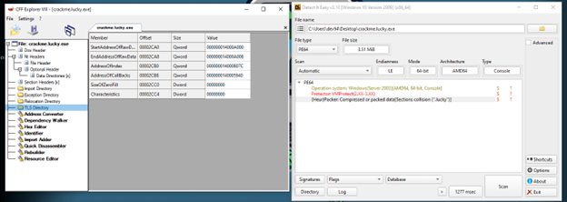
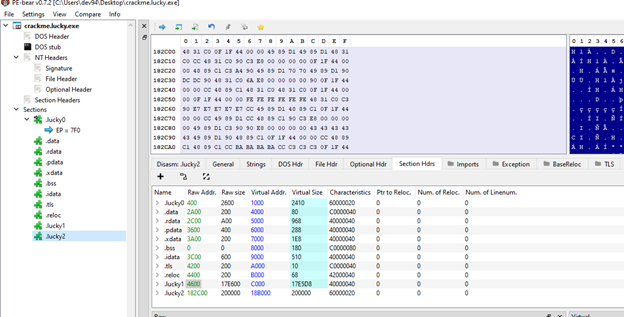
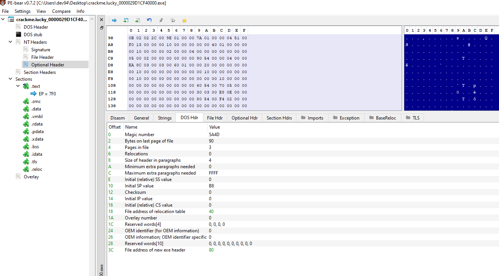
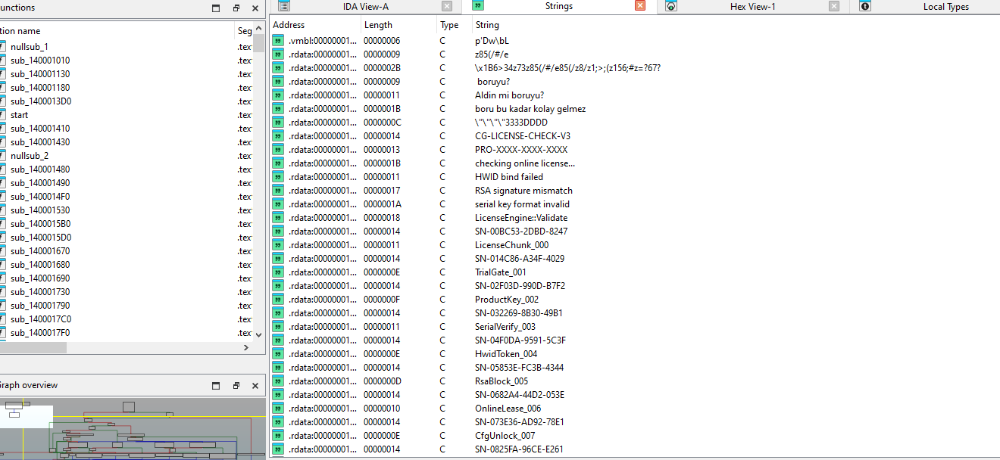
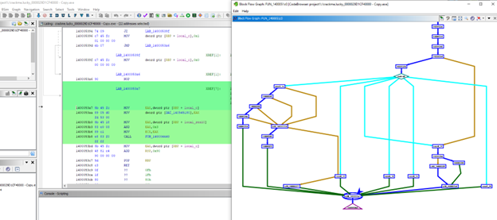

# Reverse Engineering & Solving: ArasElmas Custom Packer + Nested-VM Crackme (x64)

## Sample Identification & Metadata
* **Challenge Name:** ArasElmas's Custom Packer + Nested-VM Crackme (x64)
* **Author:** ArasElmas
* **Solver** DeepDominance
* **Difficulty:** 8/10
* **Platform:** Windows x86-64 (Console)
* **MD5:** `FB89BF31056B6F85D7E119CA15797F47`
* **SHA-256:** `32831A4842B9C59B3AFE3D2A0A5BC737BE377FC5F1070FD121102EDD3DBE4327`
* **Target Valid License Key:** `gamers 2774-8852-F1D9-648A`
* **Dumped Image Base:** `0x000029D1CF40000` / `0x00007FF623461000`
* **Tools Used:** Detect It Easy (DIE), CFF Explorer, PE-bear, x64dbg (ScyllaHide), Scylla x64, IDA Pro, Ghidra, Unicorn Engine, Z3 Constraint Solver
* **Archive Password:** `infected`

---

## Executive Summary
This repository documents the complete technical reverse engineering walkthrough for **ArasElmas's Custom Packer + Nested-VM Crackme (x64)**. The binary employs complex anti-analysis layers: **Control-Flow Flattening (CFF)**, **Opaque Predicates**, **DRx hardware-breakpoint traps**, self-modifying code (`.smc`), custom bytecode virtual machine (`.vmbl`), and encrypted troll strings.

By tracing memory execution in x64dbg under **ScyllaHide**, catching the unpacked image at base address `0x000029D1CF40000` / `0x00007FF623461000`, dumping the memory layout, and analyzing the master validation router (`FUN_1400051c0`), the underlying 10-round ARX (Add-Rotate-XOR) state engine was isolated and solved using **Z3 Constraint Solver**.

---

## Technical Walkthrough

### 1. Static Triage & Memory Section Mapping
Static triage using **Detect It Easy (DIE)** and **PE-bear** revealed compressed PE sections (`.lucky0`, `.lucky1`, `.lucky2`) and customized headers designed to disrupt standard decompilation.

* **Section Structure (PE-bear & x64dbg Memory Map):**
  * `.lucky0` (`0x00007FF623461000`): Initial packer Entry Point (`EP = 7F0`)
  * `.lucky1` (`0x00007FF62346C000`): Encrypted shellcode/payload blocks
  * `.lucky2` (`0x00007FF6235EB000`): Dynamic execution space & unpacked VM stub (`0x200000` bytes)
  * Unpacked Layout (`.text`, `.smc`, `.vmbl`, `.rdata`): Inner PE modules mapped dynamically at base `0x000029D1CF40000`.





---

### 2. Dynamic Unpacking & OEP Dumping (x64dbg)
Due to active hardware-breakpoint detection (`DR0`–`DR7` register checks), **x64dbg** was configured with **ScyllaHide** (`VMProtect x86/x64` profile) to intercept `NtGetContextThread`, `NtSetContextThread`, and `KiUserExceptionDispatcher`.

#### Unpacking Steps:
1. **API Breakpoint:** Set a breakpoint on `KERNEL32.VirtualProtect` (`0x00007FF623461877` / `0x1400091A0`) to capture memory region shifts to executable states (`PAGE_EXECUTE_READWRITE`).
2. **OEP Discovery:** Executed through the dynamic unpacker loop until a `ret` instruction jumped directly into the decrypted module space at `0x000029D1CF40000`.
3. **Memory Dumping:** Attached **Scylla x64**, rebuilt 80/80 valid API imports (`KERNEL32.dll` and `msvcrt.dll`), and saved the dumped PE as `crackme.lucky_0000029D1CF40000.exe`.


---

### 3. Decoy Analysis & Strings Isolation (IDA Pro)
Opening the dumped payload `crackme.lucky_0000029D1CF40000.exe` in **IDA Pro** exposed the `.rdata`, `.smc`, and `.vmbl` sections. The strings table contained multi-layered decoy traps designed to mislead reverse engineers:

* **Troll Messages:** `"Aldin mi boruyu?"`, `"boru bu kadar kolay gelmez"`
* **Fake License Identifiers:** `"CG-LICENSE-CHECK-V3"`, `"PRO-XXXX-XXXX-XXXX"`, `"RSA signature mismatch"`, `"HWID bind failed"`



---

### 4. Master Orchestrator (`FUN_1400051c0`) & CFG Graph Analysis
Disassembling the primary validation routine (`FUN_1400051c0`) in **Ghidra** isolated the master length router and state accumulator:

* **Length Router (`switch(param_2)`):** Processes length modes `0x10`, `0x18`, `0x1d`, `0x1e`, and `0x20`.
* **30-Byte Real Validation (`case 0x1e`):** Executes a 10-round custom ARX transformation. The 32-byte state matrix comparison does not short-circuit, accumulating differences via `OR` operations to defeat timing side-channel oracle attacks.



#### Decompiled Validation C Code Snippet:
```c
// Mode 0x1e (30-byte input) Validation Branch
case 0x1e:
    if ((((local_10 == local_14) && (local_18 != 0)) && (local_1c != 0)) && (local_20 != 0)) {
        local_c = 1; // SUCCESS
    }
    else if (local_24 == 0x1e) {
        local_c = FUN_140004640(param_1, param_2); // Decoy / Troll Loop
    }
    else {
        local_c = 0;
    }
    break;